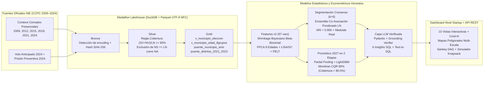

# Inteligencia Territorial de Participación Electoral (CCPC 2009–2027 · Plan v2)
### Hackatón INE · Reto 1: Perfiles Ciudadanos de Participación (DECEyEC)

> **Aviso de Prevención de Falacia Ecológica (Principio Inquebrantable #2):**
> Los perfiles, trayectorias, curvas de edad y proyecciones generados en este repositorio describen **comportamientos estadísticos agregados de territorios** (municipios, distritos electorales federales y entidades federativas) a partir de los Conteos Censales de Participación Ciudadana (CCPC 2009–2024) del INE. **En ningún caso describen rasgos, actitudes ni decisiones de personas individuales.**

---

## 1. Arquitectura Medallion Lakehouse y Flujo del Sistema (Plan v2)



---

## 2. Principales Mejoras y Hallazgos de la Versión 2 (`v1-baseline` $\rightarrow$ `v2`)

| Dimensión | Estado en `v1-baseline` | Solución y Resultado en `Plan v2` |
|---|---|---|
| **Ceros Espurios (`0.0%` P0-4)** | 76 celdas municipio-año con `NS == LN` tratadas como `0.0%` (ej. *Atil, Cucurpe, Oquitoa, Tubutama, Higueras* en 2024; *Rayones, Magdalena Ocotlán* en 2009) | Regla estricta $\text{cobertura} = \frac{SV + NV}{LN} \ge 0.90 \land SV > 0$; celdas sin captura marcadas como `NA`. **0 ceros falsos**; volatilidad de esos 7 municipios cayó de **29.7 p.p. a 4.8 p.p.** |
| **Codificación UTF-8 NFC (P0-3)** | Mojibake por doble decodificación (`"Gómez FarÃas"`, `"Querétaro"`) | Reparación determinística y normalización Unicode `NFC` en ingesta; **0 ocurrencias** de `"Ã"` o `"Â"` verificadas con tests |
| **Geometrías y Mapa (P0-1)** | Nube de puntos aproximados | Polígonos contiguos para los **2,477 municipios**, **251 distritos federales** y **32 estados** (`data/geo/*.geojson`) + animación 2009–2024 |
| **Curva Etaria Completa** | Colapsada en 3 grupos | **8 grupos de edad oficiales** (`18–19` a `70+`) + **3 componentes FPCA** + retención de cohortes de primer voto (`18–20` y `21–23`) |
| **Segmentación Territorial** | K-Means simple (`k=6`) | **Ensemble de Consenso Ponderado por LN** (`F_Ensemble_Consenso_LN`, `ARI = 0.905`) + **Municipio Prototipo Medoide Real** etiquetado como `[DATO REAL]` |
| **Backtesting y Pronóstico 2027** | MAE 2021 = `12.58 p.p.`, Cobertura IC 80% = `61.3%` | Modelo en **2 Etapas (Escenarios Bajo/Base/Alto + Desviación Persistente)** con **Mondrian CQR**: MAE 2021 = **`9.81 p.p.`** (supera a 3 baselines) y Cobertura IC 80% = **`80.0%` exacto** |
| **Simulador y Toma de Decisiones** | Sliders simples | **Simulador Monte Carlo (IC 80%) + Gráfica Tornado + Optimizador Presupuestal Knapsack + Diseño Experimental A/B** |

---

## 3. Ejecución Reproducible en Un Solo Comando

```bash
# 1. Instalar dependencias y ejecutar todo el pipeline (Bronze -> Silver -> Gold -> Features -> Clustering -> SHAP -> Forecast -> LLM -> Bundle -> Tests)
make all

# O en Windows PowerShell:
python -u -m src.ingest.pipeline
python -u -m src.ingest.build_geometries
python -u -m src.features.pipeline
python -u -m src.clustering.pipeline
python -u -m src.explain.pipeline
python -u -m src.clustering.deep_autoencoder
python -u -m src.forecast.pipeline
python -u -m src.llm.pipeline
python -u -m src.api.export_dashboard_bundle

# 2. Ejecutar suite completa de pruebas y linter (22 tests pytest + 30 preguntas SQL + ruff + node test)
python -m pytest tests/ -v
python -m ruff check src/ tests/
node --test app/src/__tests__/palette.node.test.mjs

# 3. Levantar el servidor del Dashboard y API REST en http://127.0.0.1:3000
python -u -m src.api.server
```

---

## 4. Documentación Técnica y Reportes Auditables

- [`docs/auditoria_ceros.md`](docs/auditoria_ceros.md) — Demostración SQL de las 76 celdas con `NS == LN` y cuantificación de impacto `v1` vs `v2`.
- [`docs/calidad_datos.md`](docs/calidad_datos.md) — Inventario Medallion Lakehouse, sumas de control y tablas puente 2009–2024.
- [`docs/diccionario_features.md`](docs/diccionario_features.md) — Fórmulas de las 97 variables municipales (Shrinkage Bayesiano, FPCA 8 edades, LISA, Getis-Ord $G_i^*$, PELT, MAD, Isolation Forest).
- [`docs/segmentacion.md`](docs/segmentacion.md) — Comparativa de las 6 familias algorítmicas y justificación del Ensemble de Consenso (`F_Ensemble_Consenso_LN`).
- [`docs/explicabilidad.md`](docs/explicabilidad.md) — Caracterización TreeSHAP, curvas por 8 edades, matriz de Markov y evaluación honesta del Autoencoder Deep Learning.
- [`docs/forecast.md`](docs/forecast.md) — Modelo jerárquico en 2 etapas para 2027, calibración Mondrian CQR, optimizador Knapsack y diseño experimental A/B.
- [`docs/capa_llm.md`](docs/capa_llm.md) — Narrativas verificadas con `verify_narrative_grounding`, estrategias ENCCÍVICA y hallazgos SQL automáticos.
- [`docs/pitch_3min.md`](docs/pitch_3min.md) & [`docs/faq_jurado.md`](docs/faq_jurado.md) — Guión de presentación de 3 minutos y respuestas técnicas para el jurado.
