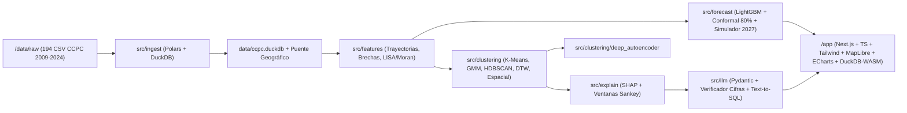

# Perfiles Ciudadanos de Participación Electoral (2009–2024) — Hackatón INE · Reto 1

> **Principio Metodológico Fundamental (Prevención de la Falacia Ecológica):**
> Todos los indicadores, modelos y perfiles desarrollados en este proyecto describen **territorios agregados (municipios como unidad principal; distritos electorales federales y entidades federativas como vistas agregadas)** a partir de datos públicos de los **Conteos Censales de Participación Ciudadana (CCPC 2009–2024)** del Instituto Nacional Electoral (INE). **Bajo ninguna circunstancia describen ni reidentifican individuos.** Las celdas con conteos `< 10` se suprimen o agregan.

---

## 1. Definición del Problema

La participación electoral en México presenta contrastes territoriales profundos: mientras algunos municipios mantienen tasas superiores al **70%** tanto en elecciones presidenciales como intermedias, otros registran caídas superiores a **20 puntos porcentuales** en comicios intermedios (como el próximo Proceso Electoral Federal **2026–2027**) o brechas generacionales de más de **18 puntos** entre personas adultas mayores (`60+`) y juventudes (`18–29`).

Diseñar campañas de educación cívica y promoción del voto uniformes —o clasificar al país únicamente en *"alta, media y baja participación"*— desaprovecha la riqueza longitudinal y demográfica de los Conteos Censales de la **DECEyEC**. Este proyecto construye un sistema reproducible de extremo a extremo que:
1. Unifica y valida las **54,872,712 filas** de los Conteos Censales 2009, 2012, 2015, 2018, 2021 y 2024 (incluyendo **Voto Anticipado 2024** y **Prisión Preventiva 2024**).
2. Segmenta los **2,477 municipios** en **6 perfiles territoriales** definidos por su trayectoria, caída presidencial $\rightarrow$ intermedia, volatilidad, brecha de género, brecha generacional y ruralidad electoral.
3. Explica cada perfil con **SHAP** y árboles sustitutos, modela sus **transiciones temporales (Sankey)**, proyecta la participación intermedia **2027** con intervalos conformales al **80%** y vincula cada perfil con **estrategias accionables (ENCCÍVICA)** y un agente **Text-to-SQL ("Pregúntale a los datos")** sobre `DuckDB`.

---

## 2. Principales Hallazgos Empíricos (Verificados en `data/ccpc.duckdb`)

1. **Autocorrelación espacial significativa:** La participación media municipal presenta un estadístico **$I \text{ de Moran Global} = 0.4782$ ($p = 0.0020$)**, confirmando corredores regionales de alta participación constante (`HH`) y polígonos de abstención estructural (`LL`).
2. **Seis perfiles territoriales diferenciados por dinámica y brechas (no solo por nivel):**
   - **Perfil 0 — Cohesión Comunitaria Sostenida:** Alta participación constante tanto en presidenciales como en intermedias y mínima volatilidad.
   - **Perfil 1 — Participación Rural Constante:** Municipios con alta proporción de secciones rurales, participación sostenida y brecha de género favorable a las mujeres (`Mujeres > Hombres`).
   - **Perfil 2 — Impulso Cívico en Ascenso:** Municipios con pendiente temporal positiva (`Theil-Sen > 0`) entre 2009 y 2024.
   - **Perfil 3 — Movilización Presidencial Selectiva:** Municipios que acuden ampliamente en elecciones presidenciales pero experimentan una pronunciada caída en elecciones intermedias.
   - **Perfil 4 — Dinámica Urbana Intermitente:** Centros urbanos y mixtos con marcada brecha generacional entre mayores de 60 años y jóvenes de 18 a 29 años.
   - **Perfil 5 — Prioridad de Reactivación Cívica:** Territorios con tendencia decreciente o rezago sostenido que requieren atención prioritaria hacia 2027.
3. **Honestidad metodológica en Deep Learning:** El **Autoencoder Temporal (`dim=6`)** alcanzó bajo error de reconstrucción (`MSE = 0.088`), pero no superó al modelo `A_KMeans_Robust` en separación dentro del espacio original de variables observables (`Silhouette 0.165 vs. 0.211`). Por transparencia metodológica, se conserva `A_KMeans_Robust` como modelo final.

---

## 3. Arquitectura del Sistema



---

## 4. Estructura del Repositorio

```text
├── data/
│   ├── raw/                  # Enlaces a los 8 directorios oficiales CCPC 2009-2024
│   ├── interim/              # Parquet particionado por año + control de totales fuente
│   ├── processed/            # Matrices Parquet y JSONs verificados para consumo analítico
│   └── ccpc.duckdb           # Catálogo DuckDB con vistas por municipio, distrito y entidad
├── src/
│   ├── ingest/               # Normalización de encodings, BOM, esquema largo y tabla puente
│   ├── features/             # Ingeniería de variables electorales, enriquecimiento y Moran/LISA
│   ├── clustering/           # Evaluación de 5 métodos + Autoencoder Temporal condicional
│   ├── explain/              # Árbol sustituto, LightGBM SHAP y transiciones por ventanas
│   ├── forecast/             # Proyección 2027 con validación temporal e intervalos al 80%
│   ├── llm/                  # Narrativas verificadas, estrategias ENCCÍVICA y Text-to-SQL
│   └── api/                  # Exportador de bundles optimizados hacia el frontend
├── app/                      # Dashboard Next.js 14 + TypeScript + Tailwind + MapLibre + ECharts
├── tests/                    # Suite pytest (18 tests incluyendo benchmark de 30 preguntas SQL)
├── docs/                     # Reportes técnicos, diccionarios, capa semántica, pitch y FAQ
├── notebooks/                # 01_eda.ipynb (Análisis Exploratorio de Datos)
├── Makefile                  # Ejecución reproducible con un solo comando (`make all`)
└── pyproject.toml            # Configuración de proyecto, pytest y ruff
```

---

## 5. Cómo Reproducir el Proyecto (`make all`)

### Requisitos
- **Python 3.11+** y **Node.js 18+**

### Ejecución del Pipeline Completo desde Cero
```bash
# 1. Instalar dependencias de Python
pip install -r requirements.txt

# 2. Ejecutar todo el pipeline (Ingesta -> Features -> Clustering -> Explain -> DL -> Forecast -> LLM -> Tests -> Lint)
make all
```

En entornos Windows sin `make` instalado, también puedes ejecutar cada fase o el workflow `/run-pipeline`:
```powershell
python -u -m src.ingest.pipeline
python -u -m src.features.pipeline
python -u -m src.clustering.pipeline
python -u -m src.explain.pipeline
python -u -m src.clustering.deep_autoencoder
python -u -m src.forecast.pipeline
python -u -m src.llm.pipeline
python -u -m src.api.export_dashboard_bundle
python -u -m pytest tests/
python -u -m ruff check src/ tests/
```

### Ejecución del Dashboard Interactivo (`app/`)
```bash
cd app
npm install
npm test          # Ejecuta pruebas unitarias/componentes con Vitest
npm run dev       # Inicia el servidor en http://localhost:3000
```

---

## 6. Resumen de Documentación Técnica y Validación en `/docs`

- [Inventario de Datos (`docs/inventario_datos.md`)](file:///c:/Users/52477/Desktop/hackaton2INE/docs/inventario_datos.md)
- [Reporte de Calidad e Integridad de Ingesta (`docs/calidad_datos.md`)](file:///c:/Users/52477/Desktop/hackaton2INE/docs/calidad_datos.md)
- [Diccionario de Variables (`docs/diccionario_features.md`)](file:///c:/Users/52477/Desktop/hackaton2INE/docs/diccionario_features.md) y [Fuentes Externas (`docs/fuentes.md`)](file:///c:/Users/52477/Desktop/hackaton2INE/docs/fuentes.md)
- [Validación de Segmentación (`docs/segmentacion.md`)](file:///c:/Users/52477/Desktop/hackaton2INE/docs/segmentacion.md) y [Evaluación de Deep Learning (`docs/deep_learning.md`)](file:///c:/Users/52477/Desktop/hackaton2INE/docs/deep_learning.md)
- [Explicabilidad SHAP y Dinámica de Transiciones (`docs/explicabilidad.md`)](file:///c:/Users/52477/Desktop/hackaton2INE/docs/explicabilidad.md)
- [Modelo Predictivo 2027 y Backtesting (`docs/forecast.md`)](file:///c:/Users/52477/Desktop/hackaton2INE/docs/forecast.md)
- [Capa LLM yCapa Semántica SQL (`docs/capa_llm.md`)](file:///c:/Users/52477/Desktop/hackaton2INE/docs/capa_llm.md) / [`docs/capa_semantica.yaml`](file:///c:/Users/52477/Desktop/hackaton2INE/docs/capa_semantica.yaml)
- [Guion de Pitch de 3 Minutos (`docs/pitch_3min.md`)](file:///c:/Users/52477/Desktop/hackaton2INE/docs/pitch_3min.md) y [10 Preguntas Difíciles del Jurado (`docs/faq_jurado.md`)](file:///c:/Users/52477/Desktop/hackaton2INE/docs/faq_jurado.md)
