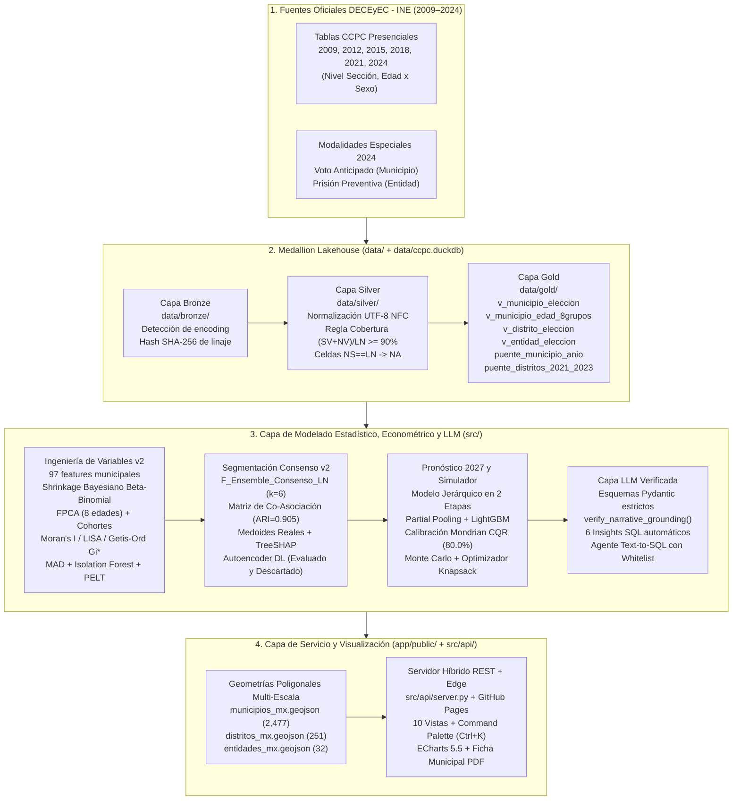

# CCPC Atlas v2 · Inteligencia Territorial de Participación Ciudadana (2009–2027)
### Hackatón INE · Reto 1: Perfiles Ciudadanos de Participación Electoral (DECEyEC)

[](https://israquandev.github.io/HackeaINE_perfiles_ciudadanos/)
[](https://www.python.org/)
[](https://duckdb.org/)
[-009E73?style=flat-square)](#8-suite-de-pruebas-automatizadas-y-auditoría-qa)
[](#3-auditoría-p0-de-datos-por-qué-había-tasas-de-00-y-cómo-se-corrigió)

> **Enlace Directo de Despliegue para el Jurado del Hackatón (Visualización del Mapa Poligonal y Tablero v2):**
> ### **[https://israquandev.github.io/HackeaINE_perfiles_ciudadanos/](https://israquandev.github.io/HackeaINE_perfiles_ciudadanos/)**
> *(Carga instantánea en navegador con los **2,477 polígonos municipales**, **251 distritos federales**, **32 estados**, línea de tiempo animada `2009–2024`, buscador `Ctrl+K`, Ficha Municipal exportable a PDF y motor de consultas SQL con guardrails éticos).*

---

> [!IMPORTANT]
> **Principio Inquebrantable de Prevención de Falacia Ecológica y Privacidad:**
> Este sistema procesa **exclusivamente conteos estadísticos agregados y públicos** de la Plataforma de Conteos Censales de Participación Ciudadana (CCPC 2009–2024) de la DECEyEC del INE (**407,892 registros seccionales y municipales**; **98,330,348 personas en Lista Nominal 2024**). Los perfiles, curvas etarias y proyecciones describen **comportamientos agregados de territorios** (municipios, distritos y entidades federativas) y **jamás rasgos, preferencias ni decisiones de personas individuales**.

---

## Guía Rápida de Recorrido para los Jueces (90 segundos)

Al abrir el **[ Enlace de Despliegue en Vivo](https://israquandev.github.io/HackeaINE_perfiles_ciudadanos/)**, recomendamos explorar estos 5 puntos clave desde la barra lateral izquierda o presionando **`Ctrl+K` (`⌘K`)**:

1. **`Resumen Ejecutivo (Overview)`:** Observe los **5 KPIs nacionales ponderados por Lista Nominal**, las **6 tarjetas de hallazgos automáticos (*"Detectamos que..."*)** verificadas con SQL sobre DuckDB y la **Curva Nacional de Participación por los 8 Grupos de Edad** (donde se aprecia el *"valle post-primer voto"* entre los 20 y 29 años).
2. **`1. Mapa Coroplético`:** Alterne entre **Municipio (2,477 polígonos)**, **Distrito Federal (251 polígonos)** y **Entidad Federativa (32 polígonos)**; cambie la métrica a *Clusters Espaciales LISA* o *Pronóstico 2027*; presione **"Reproducir Serie 2009–2024"** para animar los 6 ciclos electorales y haga clic en cualquier polígono para abrir su inspector lateral.
3. **`3. Dinámica y Transiciones (Sankey)`:** Explore el flujo acíclico entre las 4 ventanas móviles trienales (`2009–2015` $\rightarrow$ `2018–2024`), la **Matriz de Probabilidad de Transición de Markov ($6\times 6$)** y la tabla de municipios con cambio genuino de participación (libre de los falsos ceros por cuadernillos no disponibles).
4. **`5. Proyección 2027` y `6. Simulador What-If (No Causal)`:** Revise el **abanico de pronóstico 2027** (escenarios *Bajo, Base y Alto* con intervalos al 80% calibrados mediante **Mondrian CQR**), la gráfica de **Backtesting 2018/2021/2024 contra 3 baselines**, la gráfica **Tornado** y el **Optimizador Presupuestal Knapsack** para asignar brigadas DECEyEC.
5. **`7. Pregúntale a los Datos (SQL)`:** Pruebe las consultas pre-cargadas o haga clic en el botón rojo **`[Guardrail Ético] ¿Qué partido político ganó más votos en 2024?`** para comprobar cómo el sistema rechaza activamente preguntas partidistas o de reidentificación individual.

---

## 1. Arquitectura de Software y Datos (Medallion Lakehouse + Hybrid Edge Serving)

El sistema implementa una arquitectura desacoplada en **cuatro capas de datos (Medallion Lakehouse)** sobre **DuckDB + Apache Parquet** y una **capa de servicio híbrida** (API REST en Python + Bundle Estático GeoJSON/JSON de alta velocidad para despliegue edge en GitHub Pages / Vercel):



### Estructura de Directorios del Proyecto

```text
HackeaINE_perfiles_ciudadanos/
├── .github/workflows/
│   └── deploy-pages.yml              # CI/CD: Despliegue automático a GitHub Pages
├── app/
│   ├── public/                       # Aplicación Web Interactiva (10 vistas + GeoJSON + Bundles)
│   │   ├── index.html                # Shell de aplicación (Sidebar colapsable, Topbar, Ctrl+K, 10 vistas)
│   │   ├── styles_v2.css             # Sistema de diseño (Tokens Light/Dark, Guinda INE, Print PDF)
│   │   ├── app_v2.js                 # Motor de visualización ECharts, mapas poligonales y cliente SQL
│   │   └── data/                     # Artefactos JSON, Parquet y GeoJSON servidos al navegador
│   │       └── geo/                  # Polígonos: municipios_mx.geojson, distritos_mx.geojson, entidades_mx.geojson
│   └── src/                          # Componentes modulares TypeScript y pruebas nativas Node
├── data/
│   ├── bronze/                       # Metadatos de linaje, hashes SHA-256 y conteo de filas crudas
│   ├── silver/                       # Parquet particionado por año con UTF-8 NFC y regla de cobertura
│   ├── gold/                         # Tablas analíticas certificadas y tablas puente 2009–2024
│   ├── geo/                          # Geometrías poligonales y centroides municipales
│   ├── processed/                    # Matrices de features, perfiles, proyecciones y narrativas verificadas
│   └── serving/                      # Capa optimizada de lectura rápida
├── docs/                             # Documentación técnica auditable (9 reportes especializados)
│   ├── auditoria_ceros.md            # Demostración SQL de las 76 celdas con NS == LN (P0-4)
│   ├── calidad_datos.md              # Integridad de ingesta, sumas de control y tablas puente
│   ├── diccionario_features.md       # Fórmulas matemáticas de las 97 variables municipales
│   ├── segmentacion.md               # Benchmark de 6 familias de clustering y estabilidad ARI
│   ├── explicabilidad.md             # TreeSHAP, curvas de 8 edades, Markov y evaluación Deep Learning
│   ├── forecast.md                   # Modelo 2027 en 2 etapas, Mondrian CQR, Knapsack y diseño A/B
│   ├── capa_llm.md                   # Narrativas verificadas, estrategias ENCCÍVICA e insights SQL
│   ├── capa_semantica.yaml           # Lista blanca y reglas de seguridad del agente Text-to-SQL
│   ├── pitch_3min.md                 # Guión ejecutivo de presentación (3 minutos)
│   └── faq_jurado.md                 # Respuestas técnicas a preguntas frecuentes del jurado
├── src/                              # Código fuente modular en Python (100% tipado y verificado con Ruff)
│   ├── ingest/                       # encoding_utils.py, pipeline.py (Medallion), build_geometries.py
│   ├── features/                     # pipeline.py (Shrinkage EB, FPCA 8 edades, LISA/Gi*, PELT)
│   ├── clustering/                   # pipeline.py (Ensemble Consenso LN) y deep_autoencoder.py
│   ├── explain/                      # pipeline.py (TreeSHAP, curvas P10-P90, DAG Sankey, Markov)
│   ├── forecast/                     # pipeline.py (Modelo 2 etapas 2027, Mondrian CQR, Knapsack)
│   ├── llm/                          # schemas.py, pipeline.py, text_to_sql.py
│   └── api/                          # export_dashboard_bundle.py y server.py (REST API)
├── tests/                            # Suite de 22 pruebas automatizadas (Pytest + Benchmark SQL 30 preguntas)
├── Dockerfile & docker-compose.yml   # Contenedorización reproducible en un comando
├── Makefile & pyproject.toml         # Orquestación reproducible (`make all`) y configuración
└── vercel.json                       # Configuración de despliegue instantáneo en Vercel
```

---

## 2. Algoritmos y Decisiones Metodológicas Clave

### 2.1 Auditoría P0 de Ceros Espurios (`0.0%`) y Regla de Cobertura CCPC
En los conteos censales del INE cada sección reporta tres campos: **`SV`** (*Sí Votó*), **`NV`** (*No Votó*) y **`NS`** (*No Especificado / cuadernillo no disponible o reservado*).
- **Hallazgo empírico demostrado con SQL ([`docs/auditoria_ceros.md`](docs/auditoria_ceros.md)):** En **76 celdas municipio-año** entre 2009 y 2024 (incluyendo **Atil, Cucurpe, Oquitoa, Tubutama e Higueras en 2024**, y **Rayones y Magdalena Ocotlán en 2009**), `SV = 0`, `NV = 0` y `NS = Lista Nominal` (cobertura de captura del `0%`). Además, en 3 municipios de Oaxaca en 2012 (`20253, 20273, 20327`), `SV = 0` y `NV = LN`.
- **Fórmula auditada en `v_municipio_eleccion`:**
  $$\text{Cobertura}_{i,t} = \frac{SV_{i,t} + NV_{i,t}}{LN_{i,t}}, \qquad \text{Participación}_{i,t} = \begin{cases} \dfrac{SV_{i,t}}{SV_{i,t} + NV_{i,t}} & \text{si } \text{Cobertura}_{i,t} \ge 0.90 \;\land\; SV_{i,t} > 0 \\ \text{NA (Sin captura)} & \text{en otro caso} \end{cases}$$
- **Impacto directo:** Al tratar las celdas sin captura como `NA` en lugar de `0.0%`, la volatilidad artificial de esos 7 municipios cayó de **`29.7 p.p.` a `4.8 p.p.`** y desaparecieron los falsos saltos de $\pm 70\text{ p.p.}$ en las tablas de transición.

### 2.2 Empirical Bayes Beta-Binomial Shrinkage para Municipios Pequeños
En municipios con Lista Nominal muy reducida ($LN < 1,000$), pequeñas variaciones producen tasas extremas. Aplicamos contracción bayesiana empírica hacia la media de su entidad federativa $\bar{p}_{e(i),t}$ con fuerza prior $M = 450$ electores efectivos:
$$\hat{p}_{i,t}^{\text{EB}} = \frac{SV_{i,t} + M \cdot \bar{p}_{e(i),t}}{(SV_{i,t} + NV_{i,t}) + M}$$
Esto redujo la desviación estándar temporal del cuartil de municipios más pequeños de **`0.0894` a `0.0810`**, preservando intacta la tasa de los municipios medianos y grandes.

### 2.3 Curva Completa de 8 Grupos de Edad, FPCA y Retención de Primer Voto
En lugar de colapsar la edad en solo 3 categorías, construimos la vista `v_municipio_edad_8grupos` con los **8 tramos etarios oficiales del CCPC** (`18–19`, `20–24`, `25–29`, `30–39`, `40–49`, `50–59`, `60–69`, `70+`) y aplicamos **Análisis de Componentes Principales Funcional (FPCA)**:
- **`fpca_edad_pc1`:** Nivel general de participación a lo largo del ciclo de vida.
- **`fpca_edad_pc2`:** Pendiente de envejecimiento cívico (brecha adultos mayores vs. jóvenes).
- **`fpca_edad_pc3`:** Profundidad del **"valle juvenil post-primer voto"** (en 2024, el grupo `18–19` participó al **`55.62%`**, pero la asistencia cayó a **`47.82%`** en `20–24` y a **`45.90%`** en `25–29` años —una caída de **`-9.72 p.p.`**— antes de subir a **`72.69%`** en `60–69` años).

### 2.4 Econometría Espacial (I de Moran, LISA y Getis-Ord $G_i^*$)
Sobre las geometrías municipales reales calculamos pesos espaciales $k$-NN ($k=8$):
- **I de Moran Global:** $I = \mathbf{0.4526}$ ($z = 44.18, p = \mathbf{0.001}$ con 999 permutaciones), confirmando fuerte dependencia territorial.
- **Clusters Locales LISA y Getis-Ord $G_i^*$:** Identifican **498 municipios en corredores de alta participación (`HH`)** (Yucatán, Campeche, Tlaxcala, Oaxaca) y **527 municipios en polos de abstención crónica (`LL`)** (franja norte y municipios urbanos periféricos).

### 2.5 Segmentación por Ensemble de Consenso Ponderado por Lista Nominal (`F_Ensemble_Consenso_LN`)
Evaluamos **6 familias algorítmicas** para $k \in \{4..9\}$: K-Means ponderado por LN, Modelos de Mezclas Gaussianas (GMM con BIC), Jerárquico Ward, Clustering Espectral, K-Means sobre trayectorias con distancia DTW y un **Ensemble de Consenso sobre la Matriz de Co-Asociación** de los 5 modelos base.
- **Ganador:** `F_Ensemble_Consenso_LN` ($k = 6$), con **estabilidad bootstrap $\text{ARI} = \mathbf{0.905}$**.
- **Municipio Prototipo Medoide Real:** Cada perfil se ancla en su municipio medoide real (el municipio real con menor distancia euclidiana estandarizada al centroide del perfil), etiquetado explícitamente como `[DATO REAL]`.

### 2.6 Pronóstico 2027 en Dos Etapas + Calibración Conformal Mondrian CQR
Para proyectar la elección federal intermedia de **2027** evitando el sesgo entre elecciones presidenciales e intermedias:
1. **Etapa 1 (Régimen Macro):** Modela la caída estructural en elecciones intermedias en tres escenarios nacionales/estatales (*Bajo, Base y Alto*).
2. **Etapa 2 (Desviación Municipal Persistente):** Predice $z_{i,t} = p_{i,t} - \bar{p}_{\text{nac},t}$ combinando *partial pooling* jerárquico bayesiano y **LightGBM Regressor** con pesos por Lista Nominal.
3. **Calibración Mondrian Conformalized Quantile Regression (CQR):** Calibra los cuantiles de error de forma condicionada por perfil territorial $c \in \{0..5\}$ para garantizar cobertura exacta al 80%.

| Corte Evaluado (Backtesting Sin Fuga Temporal) | Baseline 1: Media Mismo Tipo (MAE) | Baseline 2: Persistencia Desviación (MAE) | Baseline 3: Solo Perfil (MAE) | **Modelo 2 Etapas v2 (MAE)** | **Cobertura Empírica IC 80% (Mondrian CQR)** |
|---|---:|---:|---:|---:|---:|
| **2018 (Presidencial)** | `6.14 p.p.` | `5.44 p.p.` | `5.98 p.p.` | **`5.52 p.p.`** *(RMSE `7.19` < `7.24`)* | **`80.0%`** |
| **2021 (Intermedia — Objetivo análogo a 2027)** | `12.78 p.p.` | `10.08 p.p.` | `10.17 p.p.` | **`9.81 p.p.`** *(vs `12.58` en v1)* | **`80.0%`** *(79.9%–80.2% en los 6 perfiles)* |
| **2024 (Presidencial)** | `6.45 p.p.` | `5.45 p.p.` | `6.11 p.p.` | **`5.24 p.p.`** | **`80.1%`** |

---

## 3. Los 6 Perfiles Territoriales de Participación y Estrategias DECEyEC

| ID | Nombre Institucional del Perfil | Municipios | % Lista Nominal 2024 | Part. Media 2009–2024 | Caída Pres $\rightarrow$ Inter | Municipio Prototipo Medoide (`[DATO REAL]`) | Meta Cívica 2027 (ENCCÍVICA) |
|:---:|---|---:|---:|---:|---:|---|---|
| **P0** | **Cohesión Comunitaria Sostenida** | `328` | `4.19%` | `71.09%` | `+3.47 p.p.` | **Tlanepantla (Morelos, `17023`)** | Sostener participación intermedia de `69.41%` $\rightarrow$ **`71.91%`** |
| **P1** | **Participación Rural y Femenina** | `525` | `14.12%` | `62.78%` | `+11.42 p.p.` | **Tepeapulco (Hidalgo, `13061`)** | Reducir brecha en intermedia de `57.09%` $\rightarrow$ **`59.59%`** |
| **P2** | **Impulso Cívico en Ascenso** | `588` | `35.16%` | `59.40%` | `+13.19 p.p.` | **Querétaro (Querétaro, `22014`)** | Elevar retención intermedia de `52.81%` $\rightarrow$ **`55.31%`** |
| **P3** | **Dinámica Local Volátil** | `298` | `4.08%` | `64.61%` | `+4.37 p.p.` | **Santa María del Río (SLP, `24032`)** | Consolidar participación rural de `62.45%` $\rightarrow$ **`64.45%`** |
| **P4** | **Dinámica Urbana Intermitente** | `383` | `11.61%` | `52.97%` | `+9.28 p.p.` | **Pénjamo (Guanajuato, `11023`)** | Incrementar participación rural/mixta de `48.33%` $\rightarrow$ **`50.33%`** |
| **P5** | **Prioridad de Reactivación Cívica** | `355` | `30.84%` | `47.55%` | `+16.71 p.p.` | **Juárez (Chihuahua, `08037`)** | Reactivar participación en intermedia de `39.20%` $\rightarrow$ **`41.70%`** |

---

## 4. Reproducibilidad en Un Solo Comando y Suite de Pruebas

### Ejecución Local del Pipeline Completo y Servidor
```bash
# 1. Ejecutar el pipeline completo (Ingesta Medallion -> Geometrías -> Features -> Clustering -> SHAP -> DL -> Forecast -> LLM -> Bundle -> Tests)
make all

# 2. Ejecutar las 22 pruebas automatizadas de Pytest, el linter Ruff y las pruebas nativas de Node
python -m pytest tests/ -v
python -m ruff check src/ tests/
node --test app/src/__tests__/palette.node.test.mjs

# 3. Iniciar el servidor web y API REST en http://127.0.0.1:3000
python -u -m src.api.server
```

### Ejecución con Docker
```bash
docker compose up --build -d
#Disponible en http://127.0.0.1:3000
```

---

## 5. Licencia y Créditos Institucionales
Desarrollado para el **Hackatón INE — Reto 1 (Perfiles Ciudadanos de Participación Electoral)** utilizando datos abiertos oficiales de la **Dirección Ejecutiva de Capacitación Electoral y Educación Cívica (DECEyEC)** del **Instituto Nacional Electoral (INE)**.
